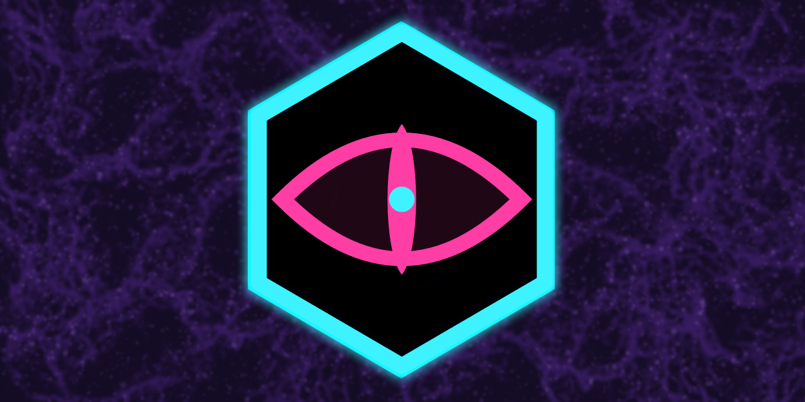

<p align="center">
  
</p>

<h1 align="center">RYUCORE // 竜核</h1>

<p align="center"><b>AI command core</b> — a self-hosted HUD for local and cloud LLMs, agents, MCP servers and skills.</p>

<p align="center">
  
  
  
  
  
</p>

<p align="center">
  <a href="#quick-start">Quick start</a> ·
  <a href="#modes">Modes</a> ·
  <a href="#configuration">Configuration</a> ·
  <a href="#security-notes">Security</a> ·
  <a href="#api">API</a>
</p>

---

A self-hosted frontend for LLMs and AI agents, built in the HEARTH HUD style. Chat with local models (Ollama, vLLM, llama.cpp, LM Studio) and cloud models (OpenAI, Anthropic, xAI Grok, Gemini, OpenRouter, Groq, Mistral, DeepSeek) side by side. Give them tools, MCP servers and skills. Run them as a **council** that votes on the best answer. A **brain** learns about you over time, and a **ghost session** keeps it out of the conversation entirely.

Everything runs in one container: a FastAPI core, a dependency-free web UI and SQLite.

| Section | What it does |
|---|---|
| **CHAT** 対話 | Sessions with streaming replies, Markdown and code blocks, reasoning (`<think>`) folds, image and text attachments, edit and regenerate, export to Markdown or JSON. Each session has toggles for **AGENT**, **BRAIN** and **COUNCIL**. |
| **BRAIN** 記憶 | Long-term memory about you: browse, search, edit, pin, forget, import and export. Pick the learning model and an optional embedding model, test recall, and watch the live *synapse log* as memories form. |
| **SKILLS** 技能 | `SKILL.md` instruction packs (Anthropic skill format). Agents load them on demand, and you can attach one to any message with `/`. |
| **MCP** 接続 | Model Context Protocol servers over stdio, Streamable HTTP or legacy SSE, with live status, tool lists, logs and Claude-Desktop-style JSON import. Built-in tools can be switched on and off here too. |
| **MODELS** 演算 | Providers: presets, API keys, connection tests, model discovery and the default model. |
| **SYSTEM** 設定 | Global system prompt, agent step limit, history limit, auto titles, the nine HEARTH themes, the boot intro and core status. |

## Quick start

```bash
cp .env.example .env            # optional: API keys, RYU_PASSWORD
docker compose up -d --build    # → http://<host>:8090
```

On first boot an **Ollama** provider pointing at `http://host.docker.internal:11434/v1` is created for you. Any cloud key in `.env` adds that provider automatically.

**To bundle Ollama** in the same compose project instead of using one on the host:

```bash
docker compose --profile ollama up -d --build
# then in .env:  RYU_OLLAMA_URL=http://ollama:11434/v1   (or edit the provider in MODELS)
docker exec -it ryucore-ollama ollama pull qwen3:8b
```

### Reaching model servers on the host

The container reaches the Docker host as `host.docker.internal`. The server must listen on an address other than loopback:

| Server | Start it with | Base URL in RyuCore |
|---|---|---|
| Ollama | `OLLAMA_HOST=0.0.0.0 ollama serve` (systemd: `Environment="OLLAMA_HOST=0.0.0.0"`) | `http://host.docker.internal:11434/v1` |
| vLLM | `vllm serve <model> --host 0.0.0.0 --port 8000` | `http://host.docker.internal:8000/v1` |
| llama.cpp | `llama-server -m model.gguf --host 0.0.0.0 --port 8080 --jinja` | `http://host.docker.internal:8080/v1` |
| LM Studio | Developer → *Serve on local network* | `http://host.docker.internal:1234/v1` |

`--jinja` lets llama.cpp use tool calling in agent mode. On Fedora and RHEL, firewalld may block container-to-host traffic: `sudo firewall-cmd --zone=docker --add-port=11434/tcp --permanent && sudo firewall-cmd --reload` (adjust the port).

## Modes

### Agent 自律

With **AGENT** on, the model gets tools and runs a loop: call a tool, read the result, decide what to do next. It stops after `RYU_MAX_STEPS` steps (default 12, changeable in SYSTEM). Each call appears as a card in the reply showing its input and output, and you can stop the run with **■ STOP** or `Esc`.

| Tool | Notes |
|---|---|
| `web_search` | Uses SearXNG when `RYU_SEARXNG_URL` is set (enable the `json` format in its `settings.yml`); otherwise DuckDuckGo's HTML endpoint, best effort. |
| `fetch_url` | Fetches a page and returns its readable text. |
| `calculator`, `current_datetime` | |
| `list_files`, `read_file`, `write_file` | Confined to `/data/workspace`. |
| `run_shell`, `run_python` | **Off unless `RYU_ALLOW_SHELL=1`.** They run inside the RyuCore container as the unprivileged `ryu` user. |
| `remember`, `recall_memories`, `forget` | Only offered when the brain is on. |
| `load_skill`, `read_skill_file` | Only offered when at least one skill is enabled. |
| *every MCP tool* | Named `<server>__<tool>`. |

The model needs tool-calling support. Most current cloud models have it, as do local models such as Qwen 3, Llama 3.1+, Mistral and gpt-oss running on Ollama, vLLM (`--enable-auto-tool-choice --tool-call-parser …`) or llama.cpp (`--jinja`).

### Brain 記憶

- **Recall.** Before each reply, the memories most relevant to your message are added to the system prompt, along with any **pinned** memories. Expand **◈ RECALLED** on a reply to see which ones were used. With an embedding model set in BRAIN → CORTEX (for example `nomic-embed-text` on Ollama), recall is semantic; otherwise it uses IDF-weighted keyword matching.
- **Learning.** After each reply, the learning model (by default, the session's own model) reads the exchange and proposes memories to add, update or forget. It is told to keep durable facts, preferences, projects, people and standing instructions, and to skip one-off tasks and secrets. Near-duplicates are merged. Every change shows as a toast and in the synapse log. Agents can also call `remember` / `forget` directly.
- **Ghost sessions** 無記憶. **◌ GHOST** (or `Alt G`) starts a session with the brain off: nothing is recalled, nothing is learned, and the memory tools are removed. A **BRAIN** toggle on any session switches it on or off from that point onward.

### Council 評議会

**⚖ COUNCIL** turns a session into a panel of 2–8 models, each with an optional name and persona (for example "skeptical security reviewer"). For every message:

1. **Deliberate.** Every member answers on its own, in parallel and streamed live.
2. **Vote.** Each member ranks the *other* members' answers. The answers are anonymised and shuffled, and no member can vote for itself.
3. **Verdict.** The answer with the most first-choice votes wins. Ties go to the Borda count, then to seat order. The winning answer becomes the reply, and the council card keeps every answer, ballot, vote bar and voter's reason.

Presets let you save line-ups such as "local trio" or "frontier panel". Members can mix local and cloud models freely.

### Skills 技能

A skill is a folder holding a `SKILL.md` plus optional extra files:

```markdown
---
name: research-brief
description: Research a topic with web_search and fetch_url, then write a sourced brief. Use when…
---
# Research brief
1. …
```

In agent mode the model sees each enabled skill's `description` and calls `load_skill` when a task matches. In any mode, typing `/` at the start of a line in the composer attaches a skill to that message. You can import a `.md` file or a `.zip` of skill folders. Two skills come pre-installed: `research-brief` and `code-review`. Skills live in `/data/skills/`.

### MCP 接続

Add servers in the MCP view, or paste the usual config:

```json
{ "mcpServers": {
    "fetch":  { "command": "uvx", "args": ["mcp-server-fetch"] },
    "memory": { "command": "npx", "args": ["-y", "@modelcontextprotocol/server-memory"] },
    "files":  { "command": "npx", "args": ["-y", "@modelcontextprotocol/server-filesystem", "/data/workspace"] },
    "remote": { "url": "https://example.com/mcp", "headers": { "Authorization": "Bearer …" } }
} }
```

stdio servers run inside the container, which includes Node.js (`npx`) and uv (`uvx`), with `/data/workspace` as their working directory. A URL ending in `/sse` (or `"type": "sse"`) uses the legacy transport; any other URL uses Streamable HTTP. Env and header values are masked in the UI after saving.

## Themes

The nine HEARTH palettes are all here: **HEARTH** 炉心, **REDLINE** 赤警報, **MECHA** 機甲, **SAKURA** 桜, **ECLIPSE** 月蝕, **KURENAI** 紅, **ABYSS** 深海, **AURUM** 黄金 and **SPECTER** 幽霊. Pick one from the swatch button, from SYSTEM, or with `Alt T`. `?theme=sakura` and `?boot=0` work as URL options.

## Keyboard

| Key | Action |
|---|---|
| `Enter` / `Shift+Enter` | Send / new line |
| `/` | Skill menu (start of a line in the composer) |
| `Esc` | Stop generating, close a menu or dialog |
| `Alt N` / `Alt G` | New session / new ghost session |
| `Alt 1` … `Alt 6` | CHAT, BRAIN, SKILLS, MCP, MODELS, SYSTEM |
| `Alt T` / `Alt Shift T` | Next / previous theme |

## Configuration

| Var | Default | |
|---|---|---|
| `RYU_PUBLISH` | `8090` | Host port (compose) |
| `RYU_PASSWORD` | — | Require a login. **Set this** if anyone else can reach the port. |
| `RYU_SECRET` | random | Cookie signing secret. If empty, one is generated and stored in the volume. |
| `RYU_ALLOW_SHELL` | `0` | `1` gives agents `run_shell` / `run_python` inside the container |
| `RYU_SEARXNG_URL` | — | SearXNG base URL for `web_search` |
| `RYU_MAX_STEPS` | `12` | Default agent tool-loop limit |
| `RYU_OLLAMA_URL` / `RYU_VLLM_URL` / `RYU_LLAMACPP_URL` / `RYU_LMSTUDIO_URL` | Ollama on the host | Seeds local providers on boot |
| `OPENAI_API_KEY`, `ANTHROPIC_API_KEY`, `XAI_API_KEY`, `GEMINI_API_KEY`, `OPENROUTER_API_KEY`, `GROQ_API_KEY`, `MISTRAL_API_KEY`, `DEEPSEEK_API_KEY` | — | Seeds the matching cloud provider. Keys are read from the environment at request time and never written to the database. |
| `TZ` | `UTC` | Used by `current_datetime` |

A provider seeded from the environment is created only once, so edits you make in the UI stick. Keys you paste into the UI instead are stored in SQLite inside the data volume.

## Data & backup

Everything lives in the `ryucore-data` volume (`/data`): `ryucore.db` (sessions, brain, providers, MCP config, settings), `skills/`, `workspace/` and `.secret`.

```bash
docker run --rm -v ryucore_ryucore-data:/data -v "$PWD":/out alpine tar czf /out/ryucore-backup.tgz -C /data .
```

The brain can also be exported and imported as JSON from BRAIN → CORTEX.

## Security notes

- **Without `RYU_PASSWORD` there is no login.** Anyone who can open the page can use your API keys, read your sessions and memories, and (with `RYU_ALLOW_SHELL=1`) run commands in the container. Keep it on a trusted LAN or behind an authenticating reverse proxy, which works with sub-paths.
- Every state-changing request needs an `X-Ryu: 1` header, which browsers won't send cross-site, so other websites can't trigger actions.
- `fetch_url` and `web_search` make outbound requests from the core and can reach LAN addresses. stdio MCP servers run with the container's privileges and network access, so only add servers you trust.
- Never commit `.env`. The `.gitignore` already excludes it.

## API

`GET /api/info` · `/api/events` (SSE) · `/api/settings` · `/api/models?refresh=1` · `/api/providers` · `/api/presets` · `/api/chats?q=` · `/api/chats/{id}` · `/api/chats/{id}/export?fmt=md|json` · `/api/brain?q=&kind=` · `/api/brain/export` · `/api/skills` · `/api/skills/{slug}` · `/api/tools` · `/api/mcp` · `/api/mcp/{id}/log` · `/healthz`

POST/PUT/PATCH/DELETE (need `X-Ryu: 1`): `POST /api/chats` · `PATCH|DELETE /api/chats/{id}` · `POST /api/chats/{id}/send {content, images[], skills[]} | {mode: "regenerate"}` (streams SSE) · `PUT /api/messages/{id}` · `PUT /api/settings` · `POST /api/providers` · `POST /api/providers/{id}/test` · `DELETE /api/providers/{id}` · `POST|PATCH|DELETE /api/brain[/{id}]` · `POST /api/brain/recall|reembed|wipe|import` · `PUT|DELETE /api/skills/{slug}` · `POST /api/skills/{slug}/enabled` · `POST /api/skills-import` · `POST /api/mcp` · `POST /api/mcp/import` · `POST /api/mcp/{id}/restart` · `DELETE /api/mcp/{id}` · `POST /api/login|logout`

## Layout

```
app/
  main.py               uvicorn entry point
  ryucore/
    server.py           routes, auth, SSE
    providers.py        OpenAI-compatible + Anthropic adapters, model discovery, embeddings
    agent.py            chat turns, agent tool loop, council deliberation/voting/tally
    brain.py            memory store, recall (embeddings or lexical), learning
    tools.py            built-in tools
    mcp.py              MCP client (stdio, Streamable HTTP, SSE)
    skills.py           SKILL.md store, zip import
    db.py               SQLite
  static/               index.html, app.js, ui.js, md.js, style.css (no build step)
  seed_skills/          skills installed on first boot
```
